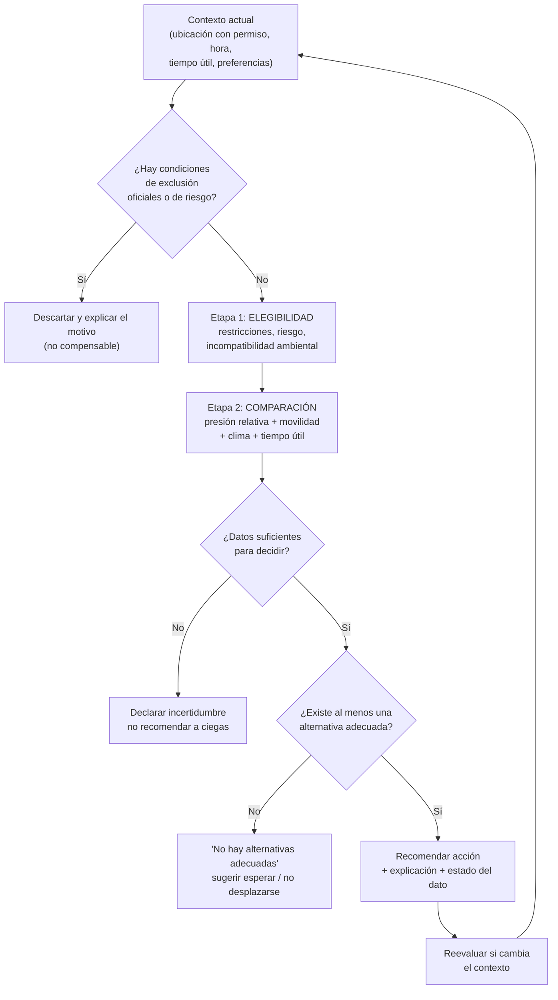
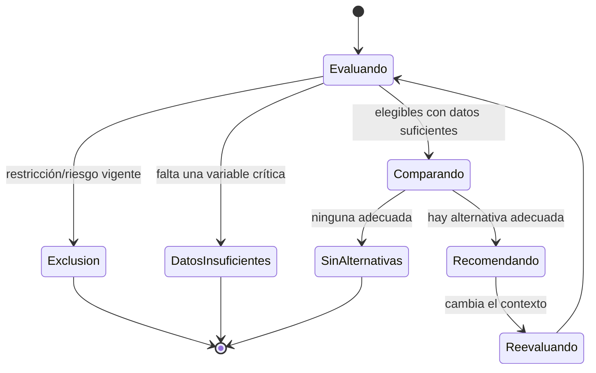
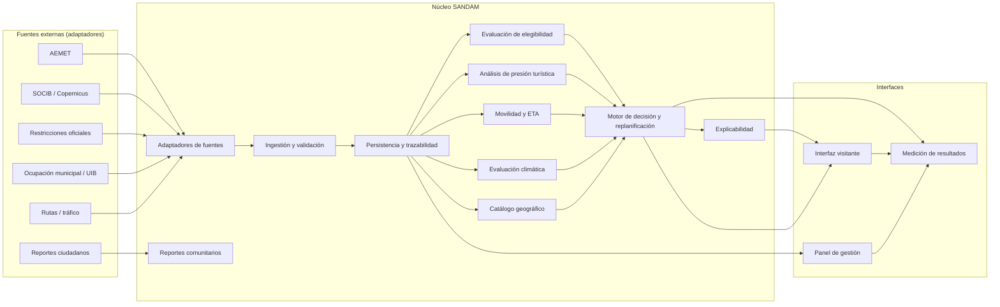
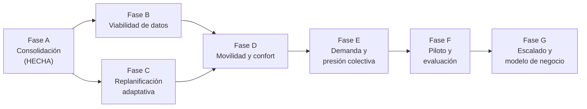

# SANDAM — Product Blueprint 0.1

**Definición estratégica, arquitectura conceptual y hoja de ruta SDD**

> **Autoridad documental.** Este documento describe **capacidades, comportamiento conceptual,
> arquitectura lógica, impacto, estrategia y evolución** del producto.
> No reemplaza a la visión ni a los principios: la fuente de verdad sobre *qué* es SANDAM y *para
> qué* es [`PRODUCT_VISION.md`](PRODUCT_VISION.md); los principios y la gobernanza vinculantes están
> en [`.specify/memory/constitution.md`](../.specify/memory/constitution.md); las reglas operativas
> para agentes, en [`AGENTS.md`](../AGENTS.md); las decisiones arquitectónicas en [`adr/`](adr/);
> las incertidumbres en [`OPEN_QUESTIONS.md`](OPEN_QUESTIONS.md); las especificaciones verificables
> en [`specs/`](../specs/).

**Versión**: 0.1 (propuesta de producto) · **Fecha**: 2026-10-19 · **Estado**: para revisión humana

**Regla de lectura.** Este documento distingue explícitamente **hecho verificado**, **hipótesis** y
**decisión pendiente**. Una afirmación de esta iniciativa no es una promesa de impacto ni una
decisión técnica tomada: es material para validar. Las decisiones tecnológicas (H3, Haversine,
clustering, proveedores, infraestructura) **permanecen abiertas** a propósito (§36 y §19 de la
instrucción de origen): aquí se documentan los problemas que resolverían y los criterios con los que
se compararán más adelante.

---

## Índice

1. [Resumen ejecutivo](#1-resumen-ejecutivo)
2. [Visión y problema](#2-visión-y-problema)
3. [Usuarios y necesidades](#3-usuarios-y-necesidades)
4. [Principios de producto](#4-principios-de-producto)
5. [Caso de uso principal](#5-caso-de-uso-principal)
6. [Replanificación adaptativa](#6-replanificación-adaptativa)
7. [Movilidad individual y colectiva](#7-movilidad-individual-y-colectiva)
8. [Adecuación climática](#8-adecuación-climática)
9. [Elegibilidad y conservación ambiental](#9-elegibilidad-y-conservación-ambiental)
10. [Reportes comunitarios y calidad de los datos](#10-reportes-comunitarios-y-calidad-de-los-datos)
11. [Fuentes e integración del portfolio](#11-fuentes-e-integración-del-portfolio)
12. [Arquitectura conceptual](#12-arquitectura-conceptual)
13. [Herramientas espaciales y de demanda (decisiones abiertas)](#13-herramientas-espaciales-y-de-demanda-decisiones-abiertas)
14. [Hipótesis de diferenciación](#14-hipótesis-de-diferenciación)
15. [Modelo de negocio](#15-modelo-de-negocio)
16. [Métricas y evaluación](#16-métricas-y-evaluación)
17. [Roadmap y dependencias](#17-roadmap-y-dependencias)
18. [Riesgos y decisiones pendientes](#18-riesgos-y-decisiones-pendientes)
19. [Siguiente especificación SDD (propuesta 002)](#19-siguiente-especificación-sdd-propuesta-002)
20. [Registro de fuentes consultadas y estado de verificación](#20-registro-de-fuentes-consultadas-y-estado-de-verificación)
21. [Criterios para declarar validada la propuesta de producto](#21-criterios-para-declarar-validada-la-propuesta-de-producto)

---

## 1. Resumen ejecutivo

SANDAM es una **plataforma de inteligencia costera y replanificación adaptativa** que ayuda a
visitantes y gestores del litoral de Mallorca a decidir considerando simultáneamente la experiencia
de la persona, la presión turística actual y prevista, la vulnerabilidad ambiental, la capacidad de
acogida y las restricciones conocidas, las condiciones meteorológicas y marítimas, la movilidad, el
tiempo útil restante y los **efectos colectivos** que la propia recomendación puede generar.

La tesis central del producto es incómoda a propósito: **una buena decisión individual no basta**.
Si muchas personas siguen la misma recomendación, el resultado agregado puede empeorar la situación
—congestión en accesos, presión sobre aparcamientos, saturación de una cala antes tranquila—. Por
eso SANDAM no se define como "una app para llenar playas" ni como un comparador de afluencia: se
define como un sistema que intenta que **las decisiones individuales, sumadas, no degraden el
conjunto**.

Qué implica esto en la práctica:

- **Entregar una decisión clara a partir de una arquitectura honesta sobre lo que sabe.** La
  sofisticación vive en los datos y en las reglas, no en la interfaz, que debe seguir siendo
  comprensible.
- **La elegibilidad ambiental y de seguridad precede a la conveniencia.** Ninguna ventaja de tiempo,
  comodidad o baja afluencia puede compensar una prohibición oficial ni una condición incompatible.
- **La ausencia de datos no es una condición favorable** (ni desfavorable): es "desconocido", y se
  comunica como tal.
- **Un núcleo, dos interfaces**: la app del visitante y el panel del gestor comparten definiciones
  de presión, elegibilidad y calidad del dato. No se mantienen dos verdades del mismo sistema.

**Estado de partida (verificado en esta iniciativa).** El repositorio tiene una primera
especificación funcional (`specs/001-sustainable-beach-recommendation/`) en estado **Draft**, con la
infraestructura SDD ya operativa y las tareas **T001–T004 completadas** (Alembic introducido y
verificado contra PostgreSQL real; metadatos de capacidad/sensibilidad añadidos con migración
`0002`). **T005–T029 siguen pendientes**, incluido el `scoring` canónico, la elegibilidad y el
etiquetado de calidad del dato. Es decir: **el MVP del producto todavía no existe**; existe una base
sólida y verificable sobre la que construirlo.

**Siguiente paso verificable.** La continuación de la especificación 001 (empezando por **T005:
esquemas aditivos de respuesta**), no una segunda especificación nueva. La propuesta de una
especificación 002 (`002-adaptive-coastal-replanning`) queda documentada en §19 y **se recomienda
posponerla** hasta que 001 entregue su MVP.

---

## 2. Visión y problema

### 2.1 El problema, en cuatro dimensiones

Coherente con [`PRODUCT_VISION.md`](PRODUCT_VISION.md) §1 y con la instrucción de origen:

1. **Asimetría de información.** Muchas personas eligen destino sin saber la ocupación real, las
   condiciones marítimas, las restricciones ni qué alternativas existen.
2. **Agregación adversa.** Una decisión individual razonable puede crear congestión vial, presión
   sobre accesos y saturación en otros lugares cuando muchos la siguen.
3. **Cambio durante la jornada.** Las condiciones (oleaje, calor, tráfico, cansancio) cambian; un
   plan inicialmente correcto puede dejar de serlo.
4. **Degradación del litoral.** La presión turística concentrada afecta a la conservación y a la
   experiencia de visitantes y residentes.

### 2.2 Qué construimos (y qué no)

Construimos una plataforma que **reduce la asimetría de información y ayuda a decidir mejor**,
evaluando conjuntamente conservación, seguridad, presión, movilidad, clima y tiempo útil, y
considerando el efecto de atraer demanda adicional hacia el destino receptor.

**No** construimos, en el alcance actual (constitución, Restricciones de Producto y Alcance):

- Una medición universal de visitantes.
- Un modelo de *machine learning*.
- Autenticación, notificaciones *push* ni multi-región.
- Una migración de plataforma.
- Un catálogo turístico universal: las actividades alternativas se amplían más allá de las playas
  solo con alcance acotado y criterios explícitos (§8.4).

La **evolución** descrita en este blueprint (replanificación, clima, panel de gestores, efectos
colectivos) es una **dirección de producto**; su entrada en alcance requiere su propia especificación
y, cuando afecte a la arquitectura, un ADR. El blueprint **no cambia** los principios de la
constitución ni el alcance del MVP: los **explicita** y ordena su evolución.

### 2.3 Resolución de una posible contradicción

`PRODUCT_VISION.md` §4 acota el MVP (sin ML, sin autenticación, etc.). Este blueprint describe un
producto más amplio. **No hay contradicción**: el blueprint es el marco de evolución; el MVP sigue
gobernado por la visión y la constitución. Se añade a la visión **solo un enlace cruzado** a este
documento (§3 de este blueprint, "Cambios documentales"), sin modificar su alcance.

---

## 3. Usuarios y necesidades

### 3.1 Usuarios y beneficiarios

| Perfil | Necesidad principal | Uso de SANDAM |
|--------|--------------------|----------------|
| **Visitante** (turista de día, excursionista) | Decidir a dónde ir *ahora* o replanificar *durante* la jornada sin desplazamientos inútiles | App de decisión: recomendación explicada, estados de incertidumbre, alternativas |
| **Residente** | Evitar colapsos locales, acceder a su litoral, saber cuándo evitar ciertas zonas | Misma app; información útil más allá de la recomendación turística |
| **Gestor del litoral** (ayuntamiento, consellería, gestor de espacio protegido) | Entender la presión agregada, anticipar concentraciones, justificar decisiones y comunicar restricciones | Panel de monitorización y apoyo a la decisión sobre **el mismo núcleo** |
| **Organismo ambiental / investigación** | Disponer de datos agregados y metodología defendible | Posible socio; no cliente directo (a validar) |
| **Empresa turística responsable** | Ofrecer información fiable y alineada | Posible canal de distribución o cliente (a validar) |

**Distinción explícita obligatoria** (instrucción de origen, §27): usuario ≠ beneficiario ≠ pagador.
No se asume que exista disposición a pagar; no se diseña precio sin validación.

### 3.2 Necesidades que no cubrimos (y por qué)

- **No cubrimos "encontrar la playa más bonita".** No es nuestro problema.
- **No somos un sistema de control de flujos.** Sin datos suficientes no se despliega control de
  accesos ni cupos; como máximo, se evitan concentraciones innecesarias *de nuestras propias
  recomendaciones* (§7.3).
- **No sustituimos a Protección Civil ni a la policía local.** SANDAM consume avisos y
  restricciones oficiales; no los genera.

---

## 4. Principios de producto

Los principios vinculantes son los de la constitución (I–IX). Este blueprint **no los duplica**;
los **traduce a consecuencia de diseño**. La jerarquía es no negociable:

1. Protección ambiental y seguridad.
2. Reducción de la presión turística.
3. Calidad de la experiencia (visitantes y residentes).
4. Conveniencia individual.

**Consecuencias de diseño que se derivan (y que ya están en la spec 001):**

| Principio (constitución) | Consecuencia de diseño en SANDAM |
|--------------------------|----------------------------------|
| I. Prioridad ambiental y de seguridad | Modelo de decisión en **dos etapas**: elegibilidad (condiciones de exclusión) → comparación de elegibles. No se usa una suma ponderada única. |
| II. Veracidad, trazabilidad y separación del dato | Toda variable relevante se clasifica (observación/estimación/predicción/caducada/desconocida) y conserva procedencia. |
| III. Dos etapas y transparencia | Toda propuesta y toda desaconsejación se explica. |
| IV. Scoring canónico único | Un solo comportamiento de puntuación; prohibidas variantes divergentes. |
| V–VII. SDD, verificación, migraciones | Nada funcional relevante sin especificación; cambios de esquema con migración reversible. |
| VIII. Secretos, privacidad, minimización | Sin secretos versionados; sin seguimiento individual persistente; recuentos agregados. |
| IX. Simplicidad y contratos explícitos | Sin Redis/PostGIS/colas/edge sin requisito verificado; ADR para decisiones relevantes. |

**Regla de oro del producto** (enunciada en la instrucción de origen):

> SANDAM debe ayudar a las personas a disfrutar del litoral **sin que las decisiones individuales,
> cuando se agregan, empeoren la situación ambiental y de movilidad del conjunto.**

---

## 5. Caso de uso principal

Recorrido canónico (instrucción de origen, §12). Se usa como **caso de diseño**, no como afirmación
de que hoy podamos ejecutarlo de extremo a extremo.

**Escenario.** Una persona visita el mercadillo de Santanyí por la mañana. Después de caminar, se
desplaza hacia Cala Llombards (≈1 h desde Palma). Al llegar descubre que hay demasiada gente y que
el oleaje es desfavorable. Quiere aprovechar lo que queda del día, está cansada y no quiere perder
otra hora en un desplazamiento que no compense.

**Lo que SANDAM debe hacer (comportamiento objetivo):**

1. Comprender la nueva situación y el **tiempo útil restante**.
2. Identificar las alternativas que satisfacen los **requisitos ambientales y de seguridad**.
3. Obtener o **estimar** tiempos de llegada según las condiciones de tráfico disponibles.
4. Evaluar la situación **prevista en cada alternativa a la hora real de llegada**.
5. Considerar afluencia, accesibilidad, esfuerzo físico, clima, tiempo útil y regreso.
6. Considerar el **efecto de atraer demanda adicional** hacia el destino receptor.
7. **Explicar qué sabe, qué estima y qué desconoce.**
8. Recomendar una **acción justificable**.
9. Volver a evaluar cuando cambien las condiciones.

**El resultado no tiene que ser otra playa.** Replanificar puede concluir que una alternativa no
compensa, que conviene esperar, o que es preferible una actividad **no costera**.

### 5.1 Flujo de decisión (conceptual)

### 5.2 Qué información recibe el usuario

Mínimo (instrucción de origen, §13):

- Por qué se recomienda o se desaconseja una opción.
- Tiempo de llegada estimado y hora prevista.
- Tiempo útil estimado para la actividad.
- Condiciones ambientales relevantes.
- Nivel de presión y **calidad de la observación**.
- Riesgos o restricciones conocidos.
- Estado y **antigüedad** de los datos.
- **Grado de incertidumbre** y por qué existe.
- Efectos previsibles del desplazamiento.
- Alternativas y **posibilidad de no viajar**.

**Regla de interfaz:** no se muestra una cifra agregada como verdad absoluta si oculta
incertidumbre significativa; no se usan puntuaciones sin explicación. La arquitectura de datos puede
ser sofisticada, pero la decisión ofrecida debe ser clara.

---

## 6. Replanificación adaptativa

### 6.1 Por qué es el núcleo diferencial

La mayoría de herramientas responden a una pregunta previa al viaje ("¿a qué playa voy?"). SANDAM
debe responder a "¿qué hago **ahora** con el tiempo y el cansancio que tengo?". Un plan no es una
secuencia inmutable: la persona puede cambiar de preferencias, encontrar una playa saturada,
descubrir oleaje desfavorable, sufrir una demora, cansarse o recibir un aviso nuevo.

### 6.2 Qué debe poder recomendar

- Continuar con el plan.
- Cambiar de destino.
- **Esperar o retrasar** la salida.
- Elegir una **actividad diferente**.
- **Evitar un nuevo desplazamiento**.
- **Solicitar confirmación** al usuario cuando la decisión dependa de una preferencia que no puede
  inferirse.

**Prohibido:** inventar disponibilidad o condiciones actuales cuando falten datos.

### 6.3 Estados y condiciones de fallo (conceptual)

Estados de resultado (alineados con el contrato de la spec 001,
`contracts/donde-ir.openapi.yaml`):

| Estado | Significado | Lo que **no** puede hacer el sistema |
|--------|-------------|--------------------------------------|
| `ok` | Hay alternativas elegibles y adecuadas | Afirmar precisión que no tiene |
| `no_suitable_alternatives` | Ninguna cumple elegibilidad y adecuación | Forzar una recomendación |
| `insufficient_data` | No hay datos suficientes para decidir con fiabilidad | Tratar lo desconocido como favorable |

### 6.4 Límite actual (honestidad)

La replanificación **completa** depende de datos que hoy **no** están confirmados: aforo en tiempo
real, proveedor de tráfico, condiciones marítimas por playa. Por tanto, el blueprint describe el
comportamiento objetivo; la **implementación por incrementos** empieza por lo que sí se puede
verificar con datos etiquetados (elegibilidad, explicaciones, estados de incertidumbre).

---

## 7. Movilidad individual y colectiva

### 7.1 Conceptos de movilidad que SANDAM necesita (sin elegir proveedor)

- Tiempo de viaje basado en **tráfico actual** cuando esté disponible.
- Estimación **convencional o histórica** cuando no haya datos actuales.
- **Incertidumbre del ETA**.
- Hora estimada de llegada.
- Accesos finales y desplazamientos peatonales.
- Dificultad o esfuerzo del recorrido.
- Aparcamiento y alternativas de transporte.
- Tiempo previsto de regreso y tiempo útil restante.

**Distinción obligatoria (FR-013):** Haversine mide **distancia geodésica** entre coordenadas; **no**
calcula carreteras, tráfico, restricciones ni accesos. Hoy el tiempo de viaje es
`Haversine × factor` y debe presentarse como **estimación** (`travel_time_is_estimate: true`).

### 7.2 Efectos colectivos y dinámica de demanda

Una recomendación **crea** demanda hacia el destino receptor. El sistema debe poder evaluar
(instrucción de origen, §16):

- Demanda adicional inducida por las recomendaciones.
- Concentración de recomendaciones por destino y franja temporal.
- Presión relativa en zonas receptoras.
- Accesos compartidos entre varias playas y cuellos de botella viales.
- Posible saturación de aparcamientos.
- Capacidad y vulnerabilidad de la zona receptora.
- **Desplazamiento de presión** hacia otros entornos.
- Consecuencias de recomendar destinos más lejanos.

### 7.3 Regla de honestidad sobre los efectos colectivos

Distinguir **medición**, **estimación** y **escenario hipotético**:

- **Sabemos** cuántas recomendaciones emite SANDAM hacia cada destino y en qué franja (medible).
- **No sabemos** la demanda turística total del destino: las personas también llegan desde otras
  fuentes y toman decisiones que no observamos. **No se puede presentar la recomendación propia
  como la demanda total.**
- **Escenario**: "si estas N personas van a este destino, la presión añadida sería X" es un
  escenario, no un hecho.

**Decisión temporal segura (mientras falten datos):** aplicar reglas de **no concentración** de
recomendaciones propias (por ejemplo, diversificar cuando hay muchas recomendaciones a un mismo
destino/ franja), **etiquetadas como heurística**, sin inventar límites de capacidad ni desplegar
control de flujos.

---

## 8. Adecuación climática

### 8.1 El clima como variable de decisión

El clima no es un panel informativo: determina **si** una actividad es adecuada, **cuándo** y
**dónde**. Debe evaluarse a la hora prevista de llegada y durante el periodo de uso.

Variables a considerar (según actividad):

- Temperatura, humedad, viento y rachas.
- Radiación solar y exposición.
- Sensación térmica / índice de estrés térmico **apropiado** (a definir: no se implementa sin
  definir variables, fuente, método y limitaciones).
- Condiciones marítimas y oleaje.
- Precipitaciones, horas de luz, sombra y servicios verificados.
- Avisos oficiales.
- Duración prevista de exposición y esfuerzo físico necesario.

### 8.2 Distinciones obligatorias

- **Condiciones meteorológicas** ≠ **sensación térmica** ≠ **exposición solar**.
- **Riesgo/aviso oficial** ≠ **preferencia de comodidad**.
- Una **estimación de confort** **no** es una valoración médica individual.
- El **viento** puede mejorar unas condiciones térmicas y empeorar otras marítimas: se evalúan
  conjuntamente los efectos relevantes.
- **No usar solo la temperatura del aire** como medida de confort.

### 8.3 Qué pasa si falta una variable crítica

Clasificación por tipo de decisión (a detallar en la especificación del subsistema):

| Categoría | Ejemplo | Efecto si falta |
|-----------|---------|-----------------|
| **Imprescindible** | Aviso oficial vigente de riesgo | Si no se puede confirmar, la elegibilidad puede quedar en `insufficient_data`; **no** se asume ausencia de riesgo |
| **Importante** | Oleaje para actividad de baño | Se degrada y se etiqueta; la recomendación de esa actividad se desaconseja o se marca |
| **Opcional** | Sombra disponible | Se muestra "desconocido"; no altera la elegibilidad |

### 8.4 Actividades alternativas (alcance acotado)

SANDAM **podrá** ampliar alternativas más allá de las playas, pero **no** se convierte desde el
principio en una guía turística universal. Criterios para recomendar una actividad alternativa:
adecuación climática, tiempo de desplazamiento, accesibilidad, horario, disponibilidad de
información y presión sobre el lugar receptor.

**Prohibido:** afirmar que una actividad está abierta o tiene plazas disponibles sin fuente
adecuada.

**Ejemplo de límite donde SANDAM debe decir "no"**: si la actividad alternativa no tiene fuente de
disponibilidad verificable, se puede proponer como **opción a confirmar por el usuario**, nunca como
hecho.

---

## 9. Elegibilidad y conservación ambiental

### 9.1 Elegibilidad primero

La etapa de **elegibilidad** decide qué playas **no deben recomendarse** por restricciones oficiales,
riesgos relevantes o incompatibilidad ambiental documentada. Es una **condición de exclusión**: no
se compensa. SANDAM **debe poder desaconsejar una playa aunque esté vacía**.

### 9.2 Capacidad de acogida: lo que hoy sabemos (y lo que no)

- No existe una capacidad de acogida **oficial y defendible** por playa en el sistema actual.
- La cifra `max_capacity` del *seed* es orientativa y **no** tiene metodología (Q1).
- Los nuevos campos de **T004** (`capacity_reference`, `capacity_method`) permiten **documentar la
  procedencia** de una capacidad cuando exista; hoy quedan `NULL` = desconocido.
- Consecuencia: **no se inventan umbrales**. Mientras no haya fuente, se usan **indicadores de
  presión relativa etiquetados** como relativos, nunca como límites ecológicos oficiales (FR-014).

### 9.3 Protección y vulnerabilidad: catálogos pendientes

`protection_status` y `vulnerability_level` existen (T004) pero **no** hay todavía un catálogo
documentado de figuras de protección, sensibilidad ecológica y niveles de vulnerabilidad (Q10). Por
tanto, quedan `NULL` = desconocido. **No se inventan valores.**

### 9.4 Regla anti-traslado

Evitar que SANDAM resuelva la saturación de una playa **trasladando** visitantes hacia un ecosistema
más sensible o con accesos insuficientes. Esto exige poder identificar vulnerabilidad y capacidad de
la **zona receptora**, no solo del origen.

---

## 10. Reportes comunitarios y calidad de los datos

### 10.1 Política conceptual de reportes

Los usuarios podrán aportar observaciones (afluencia, accesos, aparcamientos, condiciones marítimas,
incidencias). Política conceptual que debe contemplar:

- **Categorías** de reporte.
- **Fecha y lugar** de observación.
- **Caducidad adecuada a cada variable** (un aviso de medusas, de oleaje o de acceso no comparten
  la misma validez).
- **Duplicados y contradicciones**.
- **Posibilidad de manipulación**.
- **Calidad y nivel de confianza**.
- **Corroboración** con otras fuentes cuando exista.
- **Condiciones para que un reporte afecte a una recomendación**.
- **Protección de identidad y datos personales**.

**Regla de autoridad (crítica):** un reporte anónimo reciente puede aportar una señal útil, pero
**no adquiere automáticamente la misma autoridad que un cierre oficial**. Los reportes **no** se
presentan como medición oficial.

### 10.2 Contrato conceptual de observación

Contenido conceptual de una **observación** (instrucción de origen, §21):

| Elemento | Notas |
|----------|-------|
| Entidad geográfica | playa / zona / acceso |
| Variable | `occupation`, `flag_color`, `water_temp`, `wave`, ... |
| Valor y unidad | unidad explícita |
| Fuente | identificador de procedencia |
| Método de obtención | observación directa, sensor, cámara, reporte, API |
| Hora de observación | si existe |
| Hora de recepción | siempre |
| Caducidad / política de validez | por variable |
| Resolución espacial y temporal | declarada |
| Estado de validación | validado / no validado |
| Incertidumbre o calidad | solo si puede justificarse |
| Condiciones de uso y atribución | licencia |

**Separación conceptual obligatoria** (no se implementa ahora un modelo universal ni se modifican
los modelos existentes para anticipar fuentes futuras):

1. Datos **estáticos** (la playa).
2. **Observaciones**.
3. **Predicciones**.
4. **Reportes ciudadanos**.
5. **Indicadores derivados**.
6. **Recomendaciones y su justificación**.

**Persistencia:** los elementos que permitan evaluar impacto (recomendaciones emitidas por destino
y franja, observaciones con su caducidad) necesitan **persistencia histórica**; el cálculo de una
recomendación concreta puede ser **efímero**. Esto es una **decisión abierta** (ver Q-Impacto en
`OPEN_QUESTIONS.md`).

---

## 11. Fuentes e integración del portfolio

### 11.1 Cómo se evaluó el portfolio

Se inspeccionaron (solo lectura) los repositorios hermanos disponibles en el disco. **No se asume
nada por el nombre**; se documenta lo que **realmente** existe, con su evidencia.

| Proyecto | Capacidad **real** observada | Evidencia (inspección local) | Relevancia para SANDAM | Modo de integración posible |
|----------|------------------------------|------------------------------|------------------------|-----------------------------|
| **RASPAL Scraper** | Extracción/automatización con Playwright y modelos locales (Ollama), configuración por *pipelines*, caché SQLite, CI, Docker, `PUBLIC_API.md` | `README.md`, `PUBLIC_API.md`, `pyproject.toml`, estructura `src/`, `tests/` | **Ingestión automatizada** de fuentes sin API (páginas de gestores) | Como **servicio de ingestión** que produce observaciones normalizadas; nunca como fuente de verdad ambiental |
| **climapp** | Inteligencia climática B2B: integración **AEMET**, resolución de ubicación (GPS > geocodificación > IP), validación estricta (*guard clauses*), motor de riesgos/alertas, telemetría de auditoría | `README.md`, `services/`, `repositories/`, `app.py` | **Procesamiento climático** y **resolución de ubicación** a observación con hora | Reutilizar **conceptos/contratos** (no compartir BD): adaptar la normalización climática al contrato de observación de SANDAM |
| **GeoRisk Finder** | Cuadrícula **H3** (res 3), ingestión multirriesgo, PCA + K-Means/DBSCAN, MLflow, dashboard Streamlit | `README.md`, `requirements.txt` (`h3>=4.0.0`, `scikit-learn`, `mlflow`), `src/` | **Experiencia real en agregación H3 y clustering** | *Know-how* y patrones, **no** la resolución (H3 res 3 ≈ 12 300 km²: inadecuada para escala de playa). Se cita como evidencia de que H3 es viable, **no** como decisión tomada |
| **repo_clima** | Pequeño: `alertas.py`, `validacion.py`, `main.py`, `clima_dataset.csv` | estructra mínima | Bajo (prototipo) | No prioritario |
| **georisk-finder** (minúsculas) | Sin `README`; solo `PLAN_PROYECTO_JUAN.md` | listado de directorios | Bajo | No prioritario |

### 11.2 Criterios de integración (reglas)

Para cada integración se registra: **capacidad existente**, **evidencia**, **datos que
produce/consume**, **dependencias**, **modo de integración**, **limitaciones**, **condiciones de
uso**, **coste/esfuerzo aproximado** y **necesidad real para el MVP**.

**Prohibido:** integrar una capacidad solo para demostrar que los proyectos están conectados; y
compartir bases de datos o módulos internos por conveniencia sin evaluar consecuencias.

**Necesidad real para el MVP:** **ninguna** de estas integraciones es imprescindible para el MVP de
la spec 001. Son **Fase B (viabilidad de datos)** y posteriores.

### 11.3 Fuentes ambientales y de movilidad (registro de estado)

No se asume disponibilidad. Cada fuente se clasifica por **tipo de acceso**: público / API /
descarga manual / colaboración / licencia comercial / **sin acceso acreditado**.

| Fuente | Qué podría aportar | Estado de acceso | Nota |
|--------|--------------------|------------------|------|
| **AEMET** | Meteorología oficial | API pública (condiciones a revisar) | Puede usarse como **observación** etiquetada con hora y procedencia |
| **SOCIB** | Oceanografía / predicción marina | Credencial comprometida en historial (Q5) | **No** usar hasta resolver la rotación; predicción ≠ medición local |
| **Copernicus Marine** | Modelo marino regional | A verificar términos y resolución | Predicción, no observación de cala |
| **Calidad del agua oficial** | Estado de aguas de baño | A verificar (Govern/CAIB) | Fuente autoritativa; frecuencia semanal/periodicidad |
| **Restricciones/accesos** | Cierres, prohibiciones | A verificar por organismo | Es **condición de exclusión**: máxima prioridad |
| **Ocupación municipal** | Aforo (p. ej. Calvià DTI) | Prensa confirma; **API no confirmada** | Distinta cobertura/retraso/precisión por fuente |
| **Estimación de ocupación UIB** | Ocupación por cámaras + IA | Web pública; **condiciones de reutilización a revisar** | Es **estimación**, no medición; tensión con privacidad (ver §18) |
| **Proveedor de rutas** | ETA con tráfico | Sin acceso acreditado | Decisión abierta (Q3) |
| **Reportes ciudadanos** | Señal local | Interno | No es medición oficial |

> **No** se consideran las fuentes de aforo **intercambiables**: miden magnitudes distintas, con
> distinta cobertura, retraso y precisión. **No** se afirma que una fuente tiene API solo porque su
> web muestre datos. **No** se raspan aplicaciones para eludir autenticación, límites ni
> restricciones.

---

## 12. Arquitectura conceptual

### 12.1 Principio

Independiente de productos tecnológicos concretos. Se conserva como punto de partida la
arquitectura existente (**FastAPI + SQLAlchemy async + PostgreSQL**); no se plantea reescritura ni
migración de infraestructura por preferencia.

### 12.2 Responsabilidades lógicas

**No** es necesario que cada responsabilidad sea un servicio desplegable: primero **límites
lógicos**. Se evita complejidad operativa sin requisito demostrado (Principio IX).

### 12.3 Correspondencia con el repositorio actual

| Responsabilidad lógica | Dónde vive hoy (o viviría) |
|------------------------|----------------------------|
| Adaptadores de fuentes | `src/integrations/*` (varios **no usados** aún por la app) |
| Ingestión y validación | (a construir; hoy *seed* + clientes) |
| Persistencia y trazabilidad | `src/models.py`, `src/crud.py`, Alembic |
| Catálogo geográfico | tabla `beaches` |
| Elegibilidad | `src/utils/eligibility.py` (**T012**, pendiente) |
| Presión turística | `src/utils/recommendation_engine.py` (a reescribir, **T013**) |
| Movilidad / ETA | `src/utils/distance.py` (Haversine) + futuro proveedor |
| Evaluación climática | (a construir; base en `climapp` como *know-how*) |
| Motor de decisión | `src/utils/recommendation_engine.py` + `src/utils/scoring.py` (**T006**) |
| Explicabilidad | `src/utils/recommendations.py` (`T017`) |
| Reportes comunitarios | (a especificar) |
| Interfaces | `src/api/*` (visitante) y futuro panel |
| Medición de resultados | (a especificar) |

### 12.4 Límites entre capas (ya vigentes)

- `src/utils` **no** accede a base de datos ni a red.
- `src/crud` **no** conoce HTTP.
- `src/api` solo transporta.

---

## 13. Herramientas espaciales y de demanda (decisiones abiertas)

**No se decide todavía** (§36): H3 vs otras particiones, Haversine vs métodos geográficos más
apropiados, algoritmo de clustering, método de asignación/equilibrio de demanda, proveedor de
tráfico, proveedor de aforo, Redis/PostGIS, despliegue, ML.

Problemas que **podrían** resolver y sus **límites**:

| Enfoque | Problema que podría ayudar a resolver | Límite que **no** hay que olvidar |
|---------|----------------------------------------|-----------------------------------|
| **Haversine** | Distancia geodésica aproximada entre puntos | **No** da ETA ni sigue carreteras, tráfico, restricciones ni accesos |
| **H3 / particiones hexagonales** | Agregar observaciones por área, analizar patrones | **No** modela capacidad de una red vial ni resuelve congestión; la resolución debe adecuarse a la escala de playa |
| **Clustering** | Agrupar patrones de presión, destinos relacionados | Requiere datos; la agrupación espacial **no** equivale a asignar visitantes entre lugares |
| **Modelos de red vial** | Trayectos, accesos, rutas, cuellos de botella | Complejidad y coste; no para el primer piloto |
| **Análisis de demanda** | Evolución y distribución de recomendaciones y afluencia | Solo observamos **nuestras** recomendaciones, no la demanda total |
| **Optimización asignativa** | Asignar demanda a destinos adecuados con restricciones | Prematuro; exige datos y objetivos claros |

**Criterios de comparación futura** (para la fase que sí decida): precisión, escala, facilidad de
explicación, capacidad de representar accesos y adecuación a los datos reales. La comparación se
hará **con datos de prueba verificables**, no en abstracto.

---

## 14. Hipótesis de diferenciación

**Advertencia:** son **hipótesis a validar**, no afirmaciones de superioridad probada.

1. **Replanificación contextual durante el día**, ante cambios reales.
2. **Evaluación conjunta** de condiciones a la llegada, tiempo útil restante y esfuerzo de
   desplazamiento.
3. **Integración de presión turística, accesos, tráfico y vulnerabilidad ambiental.**
4. **Consideración de los efectos colectivos** de las recomendaciones.
5. **Confort térmico y condiciones de la actividad.**
6. **Tratamiento explícito** de calidad, antigüedad e incertidumbre de las fuentes.
7. **Medición** de si las recomendaciones mejoran la distribución sin perjudicar otras zonas.
8. **Interoperabilidad** con otras capacidades del portfolio.

### 14.1 Panorama competitivo (con estado de verificación)

Se documenta lo **públicamente verificable**, distinguiendo: función **anunciada por el proveedor**,
**observada en interfaz pública**, **descrita en documentación oficial**, **interna no confirmable**
e **hipótesis**. Fuentes y estado en §20.

| Producto / iniciativa | Qué hace según las fuentes | Estado de verificación | Diferencia potencial de SANDAM (hipótesis) |
|-----------------------|----------------------------|------------------------|--------------------------------------------|
| **Gemelo Digital de Turismo (Govern de les Illes Balears)** | Ocupación de playas en tiempo real, previsión de afluencia, alternativas; fase de pruebas verano 2026; ~4,6 M€ | **Anunciado por la administración + prensa**; interfaz **no** inspeccionada | Replanificación durante la jornada, efectos colectivos, incertidumbre explícita |
| **Estimación de ocupación de playas — UIB** (`ocupacioplatges.uib.es`) | Estimación de ocupación por **cámaras + IA** en playas de Baleares | **Página pública** (no inspeccionada directamente) | SANDAM **consume** estimaciones etiquetadas; no replica la medición |
| **Pilotos de sensorización Govern + UIB** | 8 proyectos piloto; cámaras en tierra + IA para conocer ocupación | **Comunicado oficial** | Uso agregado, no vigilancia individual |
| **Calvià DTI** | Ocupación en tiempo real de **6 playas**, actualizada cada ~10 min | **Prensa local**; **API no confirmada** | Integración como **fuente de estimación**, con condiciones de uso a revisar |
| **Visiona (ConectaBalear)** | +70 cámaras en directo de Baleares; app | **Web oficial + Google Play + prensa** | Visiona **muestra vídeo**; SANDAM busca **decisión** |
| **BeachPass Mallorca** | — | **No confirmado** como producto de ocupación (confusión probable con *day passes* hoteleros) | — |

**Conclusión honesta:** no se puede afirmar hoy que SANDAM sea ambientalmente superior a estos
productos; sí se puede afirmar que **ataca un problema distinto y complementario** (decisión +
efectos colectivos + incertidumbre) y que existe una **oportunidad de interoperar** con las fuentes
públicas de ocupación en lugar de competir con ellas. Esa oportunidad debe validarse en el piloto.

---

## 15. Modelo de negocio

### 15.1 Usuarios, beneficiarios y posibles pagadores

- **Usuarios**: visitantes y residentes (app gratuita, hipótesis).
- **Beneficiarios**: el propio litoral y los residentes (externalidad positiva).
- **Posibles clientes**: ayuntamientos y gestores del litoral (sistema de monitorización y apoyo a
  la decisión); organismos ambientales y de investigación (posibles **socios**); empresas turísticas
  responsables (canal o cliente, si se alinean).

**No se da por hecho que exista disposición a pagar. No se diseñan precios ni previsiones sin
validación.**

### 15.2 Problema operativo que SANDAM podría resolver a un gestor

Un gestor que **ya** tiene una plataforma pública de ocupación sigue teniendo preguntas sin
resolver: ¿cómo se distribuye la demanda **entre** destinos? ¿qué accesos se saturan por efecto
agregado? ¿cómo comunicar incertidumbre y restricciones sin generar falsa confianza? ¿cómo evaluar
el efecto de una intervención? **Hipótesis de valor:** el panel de gestión con datos agregados,
trazabilidad y análisis de efectos colectivos. **A validar con un gestor real.**

### 15.3 Principio de integridad

**Prohibido:** que patrocinadores o acuerdos comerciales determinen qué playas se recomiendan si
ello contradice los principios ambientales. La recomendación es una decisión técnica y ambiental, no
comercial.

### 15.4 Costes a evaluar (sin cifras inventadas)

Costes de adquisición y actualización de datos; rutas y geocodificación; mantenimiento de
integraciones; validación del aforo; infraestructura y operación; UX; atención y colaboración
institucional; evaluación de impacto. **Cada cifra que se use en el futuro debe llevar fuente o
supuesto explícito.** La finalidad ambiental **no** garantiza viabilidad comercial: hay que validar
las hipótesis económicas con experimentos.

---

## 16. Métricas y evaluación

### 16.1 Experiencia del visitante

- Calidad percibida de las recomendaciones.
- Utilidad tras un cambio inesperado de planes.
- Tiempo útil obtenido frente al esperado.
- Desplazamientos infructuosos evitados (si pueden medirse).

### 16.2 Movilidad

- **Error entre ETA estimado y observado.**
- Tiempo de llegada.
- Distancia recorrida por alternativa.
- Desplazamientos adicionales potencialmente inducidos.
- Presión sobre accesos y aparcamientos.
- Distribución de recomendaciones por franja y zona.

### 16.3 Medioambiente

- Evolución de la presión en zonas prioritarias.
- Posible **transferencia de presión** a destinos receptores.
- Adecuación de las alternativas a la vulnerabilidad y restricciones conocidas.
- Indicadores ambientales observables con metodología defendible.

### 16.4 Calidad de los datos

- Cobertura, caducidad, tasa de datos ausentes.
- Diferencia entre estimaciones y observaciones de referencia.
- Fiabilidad de los reportes ciudadanos.

> **Regla:** estas métricas **no** se convierten en promesas de impacto sin método de evaluación.
> Correlación **no** es causalidad: medir "menos visitantes en la playa A" no prueba que SANDAM lo
> causó.

### 16.5 Métricas ya exigibles hoy (y verificables en el MVP)

Coherentes con los `Success Criteria` de la spec 001 (SC-001..SC-007): % de respuestas con
elegibilidad explicada, % de valores etiquetados, 0 % de valores inventados con fuente caída,
reproducibilidad del orden, 0 % de falsos positivos de elegibilidad, casos de "no hay alternativas"
comunicados explícitamente.

---

## 17. Roadmap y dependencias

Se adopta la estructura de fases de la instrucción de origen, **ajustada al estado real verificado**
del repositorio.

| Fase | Objetivo | Estado | Dependencias | Criterio de salida |
|------|----------|--------|--------------|--------------------|
| **A. Consolidación del estado actual** | Confirmar repo, SDD, BD, tests. Mantener **T004** en su alcance | **COMPLETADA** (T001–T004 verificadas; T004 con migración `0002` y comprobación en PostgreSQL 16.13) | — | Hecho: Alembic operativo, metadatos documentados, tests en verde |
| **B. Viabilidad de datos** | Identificar fuentes, límites, licencias; evaluar Raspal/Climapp/GeoRisk | **Pendiente** | A; Q1–Q4, Q10 | Mapa de fuentes con acceso, licencia, resolución, antigüedad y cobertura verificados; decisiones sobre qué se puede usar |
| **C. Replanificación adaptativa** | Especificar entradas, estados, reglas de elegibilidad, errores y respuesta explicable | **En curso dentro de la spec 001** (T005–T023 pendientes) | A | MVP de 001: elegibilidad + comparación + explicaciones + incertidumbre, verificado |
| **D. Movilidad y confort** | Validar proveedor de rutas e indicadores climáticos; cálculos mínimos de ETA, tiempo útil, exposición | Pendiente | B, C | Decisión de proveedor (o decisión explícita de mantener estimación), con condiciones de uso y coste |
| **E. Demanda y presión colectiva** | Evaluar métodos espaciales y de distribución **con datos** | Pendiente | B, C, D | Comparación empírica (H3/clustering/red vial) con datos de prueba y criterios documentados |
| **F. Piloto y evaluación** | Validar funcionamiento, utilidad y efectos | Pendiente | B–E; socio gestor | Resultados medidos frente a métricas §16; decisión go/no-go de ampliación |
| **G. Escalado y modelo de negocio** | Ampliar cobertura y capacidades con evidencia | Pendiente | F | Evidencia de utilidad y capacidad operativa |

### 17.1 Dependencia crítica y orden correcto

**La Fase C está, en la práctica, en curso** a través de la spec 001. **No se debe abrir una
especificación 002 nueva** mientras 001 no entregue su MVP: fragmentaría el trabajo, duplicaría
definiciones de elegibilidad/presión (violando el Principio IV, scoring canónico único) y crearía dos
fuentes de verdad.

### 17.2 Piloto propuesto (acotado, Mallorca)

Calvià es **candidata** por existir información pública sobre ocupación de determinadas playas
(Calvià DTI), **pero no se elige definitivamente** sin verificar cobertura, reutilización permitida y
suficiencia de datos. El piloto debe permitir responder:

- ¿Se obtienen datos de ocupación **fiables**? (calidad, cobertura, retraso)
- ¿Se calculan tiempos de llegada **adecuados**?
- ¿Se identifican restricciones y vulnerabilidades **verificables**?
- ¿Se evalúan condiciones meteorológicas y marítimas a la hora prevista?
- ¿Se distingue una recomendación razonable de una que solo **traslada** la saturación?
- ¿Se miden resultados **sin confundir correlación con causalidad**?
- ¿Existe un **gestor o colaborador** interesado?

**Criterios de entrada**: al menos una fuente de ocupación con condiciones de uso claras + una fuente
de restricciones oficiales + ámbito reducido de playas. **Criterios de salida**: los siete
anteriores respondidos con evidencia; decisión explícita de ampliar o no. **No** se asume que un
modelo validado en pocas playas se extrapole a toda Mallorca.

---

## 18. Riesgos y decisiones pendientes

### 18.1 Riesgos

| Riesgo | Impacto | Mitigación |
|--------|---------|-----------|
| **Falta de fuentes de aforo fiables** | Bloquea la presión "observada" | Usar indicadores relativos etiquetados; el MVP no depende del aforo real |
| **Agregación adversa** | Atraer demanda crea congestión | Reglas de no concentración (heurística etiquetada) y evaluación de efectos colectivos |
| **Efecto de la recomendación sobre zonas receptoras** | Traslado de presión | Elegibilidad considera vulnerabilidad de la zona receptora; sin inventar capacidad |
| **Sesgo de datos** (cobertura desigual) | Recomendaciones no representativas | Declarar cobertura y no extrapolar |
| **Privacidad vs estimación por cámaras** | Riesgo reputacional/legal | Consumir solo **agregados** con condiciones de uso revisadas; no seguimiento individual (Principio VIII) |
| **Falsa confianza en cifras** | Decisiones erróneas | Etiquetado de naturaleza e incertidumbre; no presentar agregados como verdad |
| **Coste y mantenimiento de integraciones** | Insostenible | Simplicidad (Principio IX); integraciones solo con necesidad demostrada |
| **Dependencia de una sola fuente pública** | Frágil | Degradación explícita ante fallo; nunca inventar |
| **Credencial SOCIB comprometida** | Seguridad | Rotación por el propietario (Q5); no usar el cliente hasta resolverlo |
| **Documentación vs realidad** (prototipos, `CONTEXTO_MAESTRO.md`) | Confusión de fuente de verdad | Mantener la jerarquía documental de §0 de este documento |

### 18.2 Decisiones pendientes (remisión)

El registro operativo está en [`OPEN_QUESTIONS.md`](OPEN_QUESTIONS.md). Este blueprint añade
preguntas nuevas agrupadas por categoría (Datos, Fuentes y permisos, Capacidad ambiental, Aforo,
Movilidad, Clima, Reportes comunitarios, Interoperabilidad del portfolio, Arquitectura, Privacidad,
Modelo de negocio, Evaluación del impacto), cada una con: **qué necesitamos saber**, **por qué
afecta**, **qué evidencia la resuelve**, **si bloquea**, **cuándo resolverla** y **decisión temporal
segura mientras siga abierta**.

---

## 19. Siguiente especificación SDD (propuesta 002)

### 19.1 Confirmación del siguiente paso (importante)

La instrucción de origen propone `002-adaptive-coastal-replanning` como candidata principal "pero
debes confirmar que es el siguiente paso correcto según el estado real de T004 y los artefactos
existentes".

**Conclusión verificada:** **no**, no es el siguiente paso **inmediato**. El estado real es:

- La spec **001** (`001-sustainable-beach-recommendation`) está en estado **Draft** con **T005–T029
  pendientes** (scoring canónico, elegibilidad, explicaciones, calidad del dato, endpoints).
- T004 está **completada**.

Por tanto, el siguiente paso **verificable** es **continuar la spec 001** (empezando por T005), y la
especificación `002-adaptive-coastal-replanning` debe **escribirse después** de que 001 entregue su
MVP. Abrirla ahora crearía dos fuentes de verdad para elegibilidad/presión.

**Sí** procede **dejar preparada** la propuesta de 002 (a continuación), para que pueda ejecutarse
con `/speckit.specify` cuando se cumpla la condición de entrada.

### 19.2 Propuesta de `002-adaptive-coastal-replanning`

**Problema.** La spec 001 responde a "¿a qué playa voy ahora?" con una foto del momento. No cubre el
recorrido completo durante la jornada (cambio de condiciones, cansancio, tiempo útil, regreso,
actividades alternativas, posibilidad de no desplazarse).

**Objetivo.** Especificar el comportamiento de **replanificación contextual**: dado un contexto
(ubicación con permiso, hora, tiempo útil, preferencias declaradas y estado actual), producir una
decisión revisada y explicable, que puede ser "continuar", "cambiar", "esperar", "otra actividad" o
"no desplazarse".

**Usuarios implicados.** Visitante (principal); residente (mismo motor); gestor (información
agregada, no decisión individual).

**Alcance mínimo (a acotar en `/speckit.specify`):**

- Entradas: contexto de usuario; tiempo útil; preferencias declaradas; estado de las playas
  (reutilizando la elegibilidad y el scoring canónico de 001).
- Salidas: acción recomendada + explicación + estado del dato + incertidumbre + alternativas.
- Reglas de **elegibilidad heredadas** de 001 (no redefinirlas).
- Estados: `continuar`, `cambiar_destino`, `esperar`, `actividad_alternativa`, `no_desplazarse`,
  `insufficient_data`, `no_suitable_alternatives`.
- Condiciones de fallo: fuente caída, dato caducado, ETA no disponible, sin tiempo útil suficiente,
  preferencia no inferible → **solicitar confirmación**, nunca inventar.

**Dependencias de datos.** ETA (proveedor o estimación etiquetada); clima a la hora prevista;
ocupación/estado de la playa elegida; restricciones vigentes. **Todas** son dependencias abiertas
(Q2, Q3, Q4): la spec 002 debe poder entregar valor **sin** ellas, degradando explícitamente.

**Requisitos ambientales y de movilidad.** La replanificación **no puede** saltarse la elegibilidad
ni trasladar presión a zonas vulnerables (§9.4); debe considerar la no-concentración (§7.3).

**Criterios de aceptación preliminares.**

1. Dado un plan válido y un cambio de contexto, el sistema produce una decisión revisada explicable.
2. Ninguna recomendación de 002 puede violar una condición de exclusión de 001.
3. Con datos insuficientes, el estado es `insufficient_data` y **no** hay recomendación forzada.
4. El sistema puede recomendar **no desplazarse** y explicarlo.
5. Determinismo con entradas idénticas (cuando el método sea determinista).
6. 0 % de valores inventados con fuente caída.

**Decisiones que necesitan evidencia antes de planificar la implementación.** Proveedor de ETA
(Q3); fuente de ocupación (Q2); clasificación de vulnerabilidad de la zona receptora (Q10);
criterios de "actividad alternativa" (§8.4); persistencia del histórico para medir impacto.

### 19.3 Condición de entrada para escribir 002

**Se cumple cuando** la spec 001 alcanza su MVP verificado (elegibilidad + scoring canónico +
explicaciones + calidad del dato) según `specs/001-.../quickstart.md`. Hasta entonces, **no** crear
`specs/002-adaptive-coastal-replanning/`.

---

## 20. Registro de fuentes consultadas y estado de verificación

### 20.1 Fuentes internas (inspeccionadas directamente)

| Fuente | Afirmación usada | Cómo se verificó | Estado |
|--------|------------------|------------------|--------|
| Repositorio SANDAM | Rama, commits, T001–T004, T005–T029 pendientes, migraciones, tests | `git`, lectura de archivos | **Verificado** |
| `specs/001-.../{spec,plan,tasks,data-model}.md` y `contracts/` | Requisitos, contrato, tareas | Lectura directa | **Verificado** |
| `docs/{PRODUCT_VISION,OPEN_QUESTIONS,MIGRATIONS}.md`, `docs/adr/*` | Visión, incertidumbres, ADR | Lectura directa | **Verificado** |
| `.specify/memory/constitution.md` | Principios I–IX y alcance | Lectura directa | **Verificado** |
| `RASPAL_SCRAPER` | Scraping/Playwright/Ollama, `PUBLIC_API.md`, Docker, CI | `README.md`, estructura, `pyproject.toml` | **Verificado (local)** |
| `climapp` | AEMET, resolución de ubicación, validación, motor de riesgos | `README.md`, `services/`, `repositories/` | **Verificado (local)** |
| `GeoRisk_Finder` | H3 (`h3>=4.0.0`), clustering, MLflow, Streamlit | `README.md`, `requirements*.txt`, `src/` | **Verificado (local)** |

### 20.2 Fuentes externas (vía búsqueda web; interfaces **no** inspeccionadas directamente)

| Fuente | Afirmación usada | Verificación | Estado |
|--------|------------------|--------------|--------|
| Noticias (ultimahora.es, economiademallorca.com, destinosinteligentes.es, diariodeibiza.es) | Gemelo Digital de Turismo de Baleares: ocupación en tiempo real, previsión, fase de pruebas verano 2026, ~4,6 M€ | Titulares y resúmenes de búsqueda | **Anunciado por proveedor/administración; no verificado en interfaz** |
| `ocupacioplatges.uib.es` | Estimación de ocupación de playas de Baleares por cámaras + IA | Resumen de búsqueda con contenido de la página | **Página pública; no inspeccionada directamente** |
| `caib.es` | 8 proyectos piloto de sensorización Govern+UIB con cámaras e IA | Comunicado oficial en resultados de búsqueda | **Documentación oficial (resumen de búsqueda)** |
| Prensa local (mallorcadiario.com, destinosinteligentes.es, diariodemallorca.es, mallorcacaprice.com) | Calvià DTI: ocupación de 6 playas en tiempo real, cada ~10 min | Titulares/resúmenes | **Prensa; API de datos no confirmada** |
| `visiona.conectabalear.com`, Google Play, blog.conectabalear.com | Visiona: +70 cámaras en directo, app | Páginas y ficha de app en resultados | **Web oficial/app; función observada por descripción** |
| Búsquedas sobre "BeachPass Mallorca" | Posible producto de ocupación | Resultados apuntan a *day passes* hoteleros | **No confirmado** |

> **Ninguna** afirmación competitiva de §14 se usa como prueba de carencia en un competidor. La
> ausencia en una página comercial **no** implica que una función no exista.

---

## 21. Criterios para declarar validada la propuesta de producto

La propuesta de producto (este blueprint) se considerará **validada** cuando:

1. **Revisión humana explícita** del documento por el propietario (decisión registrada).
2. **Coherencia verificada** con visión, constitución y especificaciones (sin contradicciones
   abiertas no registradas).
3. **Caso de uso principal** reproducible en un piloto acotado de Mallorca (Fase F) con criterios de
   éxito medibles de §16.5 y §16.2/§16.3 donde existan datos.
4. **Al menos una fuente de ocupación** con condiciones de uso verificadas y **una fuente de
   restricciones oficiales** integradas como observaciones etiquetadas.
5. **Demostración de no-traslado**: en al menos un escenario de prueba, SANDAM no recomienda como "buena
   alternativa" una playa vulnerable o sin capacidad justificada (FR-007).
6. **Trazabilidad**: toda decisión de recomendación es explicable y cada valor relevante está
   etiquetado por naturaleza y procedencia.
7. **Evaluación con un gestor o colaborador** que valide el problema operativo (§15.2).

**Mientras estos criterios no se cumplan**, este documento es una **propuesta**, no una validación.
No se marcará ninguna tarea SDD como terminada sin completar sus criterios de aceptación.

---

## Anexo A — Cambios documentales de esta iniciativa

Ver el informe entregado en la conversación. Resumen:

- **Nuevo**: `docs/PRODUCT_BLUEPRINT.md` (este documento).
- **Actualizado**: `docs/OPEN_QUESTIONS.md` (nuevas preguntas estratégicas agrupadas por categoría).
- **Actualizado**: `docs/PRODUCT_VISION.md` (solo enlace cruzado; sin cambios de alcance).
- **Actualizado**: `README.md` (enlace al blueprint en "Documentation").
- **No modificado**: `src/` (modelos, esquemas, API), `alembic/`, `specs/001-.../` (excepto lo ya
  hecho en T004), constitución y ADR existentes.

## Anexo B — Nota de seguridad (incidencia SOCIB)

La credencial SOCIB del historial de git (Q5) **sigue registrada como comprometida** hasta que el
propietario confirme su rotación/revocación. **No** se expone su valor, **no** se ha copiado a ningún
archivo y **no** se afirma que esté resuelta. La purga del historial es una acción **separada** y
**destructiva** que requiere decisión explícita.
